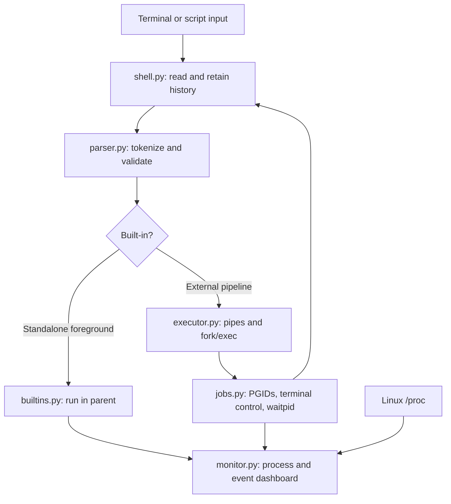

# Architecture and design

## Research question

How can a user-space shell coordinate concurrent processes, transfer terminal ownership safely, and expose the resulting process lifecycle without implementing a kernel?

MASH is an educational implementation of a limited Unix shell. It is useful for studying IPC, descriptor inheritance, process groups, signal handling, terminal control, and resource observation. Python keeps the implementation readable while its `os` interfaces expose the relevant kernel operations.

## Components



The parser finishes validation before any child is launched or redirection file is opened. Built-ins in pipelines/background jobs are rejected explicitly. `cd` must run in the parent: changing a child's directory would not change the next prompt's working directory.

## Grammar

```ebnf
line         = pipeline, [ "&" ] ;
pipeline     = command, { "|", command } ;
command      = { word | redirect } ;  (* at least one nonempty command name *)
redirect     = ( "<" | ">" | ">>" | "2>" | "2>>" ), filename ;
filename     = word ;                 (* must not be empty *)
word         = { unquoted | quoted | escaped } ;
```

Whitespace separates words. Quotes can concatenate fragments and preserve empty arguments. Single quotes preserve all enclosed characters. Outside single quotes, backslash escapes the next character; within double quotes it only removes the backslash before `\`, `"`, `$`, or a backtick. Expansion is deliberately absent. A quoted `|` is an argument, not a pipe. A `#` beginning an unquoted word starts a comment. `&` is allowed only at the end. Syntax has no command lists or multiline continuation.

Each parsed command stores its argument vector and an ordered list of file redirections. Only an unquoted `2>` or `2>>` at a word boundary selects stderr. This is not a general file-descriptor grammar.

## Pipeline launch protocol

1. Flush parent stdout/stderr before forking to avoid duplicated Python output buffers.
2. Allocate one data pipe per connection and a separate launch gate pipe.
3. Fork every command. Both parent and child call `setpgid`, grouping the pipeline under the first child's PID. Doing it on both sides avoids depending on scheduling order.
4. Each child resets inherited signal dispositions and blocks on the launch gate. The gate prevents it from reading the terminal before the parent gives its group foreground ownership.
5. Register every PID with the job manager. Close the parent's copies of data-pipe ends.
6. For a foreground job, transfer terminal ownership with `tcsetpgrp` before closing the gate writer. For a background job, release the gate without transferring ownership.
7. Children connect pipeline endpoints with `dup2`, close every inherited data-pipe end, apply explicit file redirections in source order, and call `execvp`. Redirections override pipeline endpoints.
8. The parent waits for foreground events or returns to the prompt for a background job. A failed partial launch kills and waits for already-created children and closes allocated descriptors.

All stages run concurrently, so a pipe larger than its kernel buffer does not require its producer to finish before the consumer starts. Closing unused descriptors is essential: a leaked writer prevents EOF from reaching a reader.

## Job and terminal ownership

One pipeline is one job and one process group. Each process stores its argument vector, observed state, and eventual exit status. Job state is derived from its members: Done when all exited, Stopped when all remaining members are stopped, otherwise Running. The final stage determines the pipeline's return status.

An interactive shell first acquires its own foreground process group. It ignores terminal-stop signals while managing terminal ownership. Children restore default signal handling. The terminal consequently delivers Ctrl+C and Ctrl+Z to the foreground job's group, including all stages of a pipeline. `fg` restores saved job terminal modes and resumes the group; the shell reclaims its terminal and restores its own modes after a stop or exit. Noninteractive Ctrl+C is forwarded to the foreground process group because there is no terminal handoff.

`waitpid` is the authoritative source for stop/continue/exit events. The SIGCHLD handler reaps only known background children; foreground waiting owns the current foreground group. This avoids stealing wait events from the foreground waiter. A reentrancy guard defers overlapping reaping requests. Signal handlers do not print notifications, avoiding output interleaving with the prompt. Notifications are printed at a subsequent prompt iteration.

No job can detach itself through a MASH built-in. Normal `exit` refuses active jobs; forced exit or EOF sends HUP/CONT to owned groups and applies bounded cleanup. Programs that deliberately create new sessions or escape their process group are outside this shell's ownership model.

## Observation and limits

The dashboard reads `/proc/PID/stat` and `/proc/uptime`. It calculates RSS using the platform page size and CPU lifetime averages using the platform clock tick rate. It reports metric lookup races as `n/a`, since a process may exit between reaping and reading `/proc`.

Pipeline arrows express membership and configured connectivity. Explicit redirections may replace an endpoint, so an arrow is not proof that bytes currently flow between two processes. Launch records describe successful parent-side fork/group registration; they do not prove that exec succeeded. Stop/continue/exit records describe events actually observed through waitpid. No fake scheduler or kernel-module events are generated.

## References

- [Python OS interfaces](https://docs.python.org/3/library/os.html): fork, exec, descriptors, process groups, wait statuses.
- [Python signals](https://docs.python.org/3/library/signal.html): dispositions and Python handler execution.
- [Python terminal attributes](https://docs.python.org/3/library/termios.html): preserving terminal modes.
- [Linux proc PID stat](https://man7.org/linux/man-pages/man5/proc_pid_stat.5.html): field definitions used by the dashboard.
